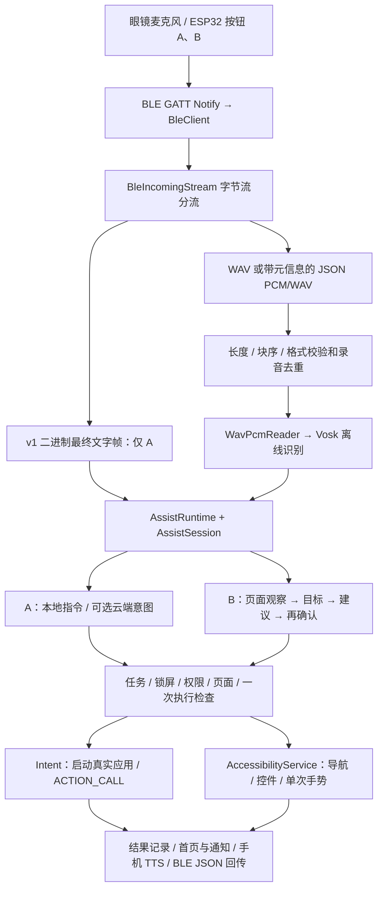

# 硬件语音通信与手机权限控制链路（0.8.0）

面向硬件、Android 和接手合并的 agent。核对日期：2026-10-25；软件基线：`cn.seniorvoice.demo`，`versionName=0.8.0`、`versionCode=21`。本文依据当前源码整理；路径均相对 Android 工程根目录（精简包中的 `源码/`）。

本链路将眼镜/ESP32 输入转为手机动作：BLE 接收 → 协议校验 → 文字或离线 ASR → A/B 调度 → 权限及任务检查 → 系统 Intent / 无障碍执行 → 结果回传和手机 TTS。手机端实现已存在；本项目没有可据此编译的完整固件，不能将手机支持的协议等同于当前板端已经实现。本文没有新增固件、重编 APK 或完成实机验收。

## 1. 按钮定义与整体结构

**交互约定（以用户本次确认为准）：A、B 是两个独立实体按钮，没有业务抢占关系；一般不会同时触发，即使同时出现也不应仅因另一个按钮触发而取消本次请求。** `source_button` 用来区分输入来源，不表示优先级。共享 BLE 通道仍需保持消息完整和顺序，不能交错帧字节；这是传输约束，不是按钮抢占。

**实现差异：现有 0.8.0 APK/源码包含 A 启动取消 B、A 活跃时拒绝 B 的旧调度逻辑，与上面的交互约定不一致。本文记录该事实用于接手核对，不将其作为设计要求；本次只修正文档，未修改源码或重编 APK。** 合并时应按各自按钮和 task/event/prompt 归属处理输入，继续保留权限、页面有效性和重复执行检查。同一时间按下的实机行为仍需联调验证，不能把“同时出现没问题”的交互约定当作旧 APK 已通过并发测试。



`AssistRuntime` 是接收与业务入口，`AssistSession` 在主线程管理 A/B 任务。`VoiceForegroundService` 维持用户已开启的后台连接；Activity 只负责 UI，不应独占 BLE 或在退到后台时直接销毁运行时。`NextActionAccessibilityService` 提供跨应用观察和操作能力，但其名称不表示 A/B 必须调用独立 NextAction 预测服务。

现有实现中，新 A 启动会清理旧 B 的提示、录音、ASR、模型请求和待执行候选，并增加任务代际；这是待调整的旧实现行为，不是按钮设计。所有异步结果回到主线程后仍要检查所属任务、连接与识别代际；适配独立按钮时不要删除这些有效性检查，也不要让一个按钮的任务代际无条件使另一个按钮失效。

## 2. BLE 连接与字节流约定

### 2.1 GATT 通道

| 方向/用途 | 默认 UUID | 当前要求 |
| --- | --- | --- |
| Service | `6e400001-b5a3-f393-e0a9-e50e24dcca9e` | 设置可改，必须与真实固件一致 |
| 板 → 手机 Notify | `6e400003-b5a3-f393-e0a9-e50e24dcca9e` | 支持 Notify 或 Indicate，并完成 CCCD 订阅 |
| 手机 → 板 Write | `6e400002-b5a3-f393-e0a9-e50e24dcca9e` | 当前手机代码要求 `PROPERTY_WRITE`，使用带响应写入 |

连接顺序：扫描/选择设备 → GATT 连接 → 服务发现 → 请求 MTU → 订阅通知 → 验证可写特征 → 双向业务通信。系统蓝牙“已配对”不代表这些步骤已完成。手机请求 MTU 247 和高连接优先级，实际值由双方协商；MTU 协商与 CCCD 写入串行，协商等待约 2.5 秒后继续订阅。

手机下行仍按 **20 字节**切分 UTF-8 字节，逐次带响应写入；每条控制消息尾部补 `\n`。固件必须按流拼接，不能把一次 Write 当作完整 JSON。手机当前拒绝超过 8192 字节的单条下行消息或超出队列容量的排队请求；`send=true` 只表示已排队，不证明固件已接收或执行。

板端上行同样是字节流：一条消息可跨多个 Notify，一次 Notify 也可能包含多条消息。JSON 使用 UTF-8，建议每条末尾 `\n`；二进制 WAV/文字帧按各自帧结构解析。同一条 JSON 或二进制帧未结束时，不能插入另一条消息的字节。断线丢弃半帧；接收约 30 秒无进度会清理未完成数据。

### 2.2 三种语音输入，合并时不要混用

| 输入 | 识别在哪端 | A/B 适用性 | 主要限制 |
| --- | --- | --- | --- |
| v1 二进制最终文字帧 | 硬件自行识别 | 仅 A | 无按钮与 prompt 上下文；语言字段只接受 `en` / `--` |
| 带元信息的 JSON PCM/WAV 分块 | 手机 Vosk | A、B；A 也可回答指定确认 | 必须传 session/task/event/button，B 必须绑定最新 prompt |
| 旧裸 RIFF WAV / 无来源兼容输入 | 手机 Vosk | 仅作为 A 兼容入口 | 不能确认旧操作，不能推断 B；进入元信息模式后不能任意退回匿名音频 |

当前没有“任意裸 PCM 字节都可直接识别”的兼容承诺。PCM 必须使用下一节的显式封装；不能把 MP3、AAC 或 I²S 32-bit 容器标为 16-bit PCM。

## 3. 推荐录音协议：JSON 元信息 + PCM 分块

### 3.1 标识与音频格式

推荐 **16000 Hz、单声道、16-bit 小端有符号 PCM**，每条指令约 2–8 秒。固件每次启动生成新的 `session_id`；每次新录音生成新的 `id/event_id`；A 的新任务使用新的 `task_id`。标识符格式为 `[A-Za-z0-9._:-]{1,96}`。

| 字段 | 含义与绑定 |
| --- | --- |
| `id` | 上行消息/录音 ID；同一录音的 meta/start/chunk/end 一致；下行通常叫 `event_id` |
| `data.session_id` | 固件启动会话；不要每个分块换值 |
| `data.task_id` | A 任务 ID；B 必须使用手机下发的 `b-<prompt_id>` |
| `data.source_button` | `A` 或 `B`；不能从识别文字猜按钮 |
| `data.purpose` | A 为 `command`；B 为 `assist_reply` |
| `data.prompt_id` | B 必填且等于手机当前询问；A 回答澄清/确认时也必须回传对应值 |
| `data.format` / `size` | `pcm_s16le` 时 size 为原始 PCM 字节数，不含 WAV 头；`wav` 为整个 WAV 文件字节数 |

输入解析允许 `v:1/2`；本交接统一用 `v:2`。字段位置要保留：录音元信息在上行的 `data` 内，手机下行的 ack/result/prompt 关键字段位于顶层，不能强制把收发都改成同一层结构。

### 3.2 A 一次录音的发送顺序

1. 按下 A 时立即发 `button_start`，让手机关联本次 A 录音。按按钮约定，这不代表取消 B；旧 APK 的取消行为见第 1 节实现差异。
2. 录音结束后发同一录音的 `recording_meta`，带最终 size。
3. 等到该 event_id 的 `ready_for_audio`，发 `audio_start`；收到 `audio_started` 后连续发 chunk。
4. 发完所有块再发 `audio_end`。手机收到完整音频后回 `audio_received`，随后离线识别并返回最终 `result`。

```json
{"v":2,"type":"button_start","id":"rec-a-001","data":{"session_id":"boot-001","task_id":"a-001","source_button":"A","purpose":"command","format":"pcm_s16le"}}
{"v":2,"type":"recording_meta","id":"rec-a-001","data":{"session_id":"boot-001","task_id":"a-001","source_button":"A","purpose":"command","format":"pcm_s16le","size":32000}}
{"v":2,"type":"audio_start","id":"rec-a-001","data":{"format":"pcm_s16le","size":32000,"sample_rate":16000,"channels":1,"bits_per_sample":16}}
{"v":2,"type":"audio_chunk","id":"rec-a-001","data":{"index":0,"base64":"<第0块原始PCM的Base64>"}}
{"v":2,"type":"audio_chunk","id":"rec-a-001","data":{"index":1,"base64":"<第1块原始PCM的Base64>"}}
{"v":2,"type":"audio_end","id":"rec-a-001","data":{"chunks":2}}
```

上例 Base64 是占位，不能原样发送；32000 字节是 1 秒演示长度。两块解码后总字节数必须恰好等于 size；chunks 必须等于真实块数。实际建议每个 chunk 载荷约 512–2048 字节，完整 JSON 再按协商的 ATT 载荷切 Notify。块序从 0 连续递增，不支持缺块、乱序或重复块自动修复。

**没有逐 chunk ACK**。不要每块都等待手机确认，否则会卡死；固件按 BLE 协议栈拥塞/发送完成状态控制发送速率。手机的 `button_start` 和 `recording_meta` 都可能回 `ready_for_audio`，固件应按自身录音阶段消费，不能因每个 ready 都重发音频。

WAV 分块沿用相同流程，将 format 改为 `wav`、size 改为整个 RIFF 文件长度；不能把 PCM 元信息与裸 WAV 拼接在一起。原始 WAV 二进制路径只能在元信息接受后完整连续传输，不可在 WAV 中插 JSON 控制消息。

### 3.3 完整性、容量与时限

- `BleAudioTransfer` 校验录音 ID、连续 index、Base64、累计字节数、chunks 和落盘长度；PCM 自动补 44 字节标准 WAV 头。
- JSON PCM 接受 8000–48000 Hz、1/2 声道、16-bit；长度必须按 `channels × 2` 对齐；重建 WAV 不超过 10 MiB，PCM 最长 180 秒。
- WAV 校验接受整数 PCM、8000–48000 Hz、1/2 声道、8/16/24/32-bit，最长 180 秒；不接受浮点/压缩音频、错误 RIFF 长度或不完整采样帧。推荐仍统一 16 kHz/mono/16-bit。
- 元信息后等待音频约 90 秒；分块期间每次进度刷新约 30 秒无进度超时；A 启动后的任务总等待还受约 120 秒超时限制。180 秒是格式上限，不表示业务等待能容纳 180 秒录音。
- 已验证录音在外部动作之前，以 `BLE对端 + session_id + event_id` 保存持久去重信息；无效或过期数据不执行。去重记录是本地有限记录，不能当作跨设备、跨重装的全局 exactly-once 保证。失败重试应重新录音并换 event_id。

## 4. 硬件已识别文字的 v1 兼容协议

```text
A5 5A | version:01 | type:01/02 | seq:u32LE | N:u16LE |
language:2字节 | body:N字节UTF-8 | CRC:u16LE | 0D 0A
```

固定开销 16 字节，正文最多 1024 字节。type `01` 是最终指令文字，language 必须为 ASCII `en`；type `02` 是状态/错误，language 必须为 `--`，只显示和记录，不执行。UTF-8 禁止无效编码与 NUL。中文在传输上能编码，但当前代码没有放开 `zh` 语言标记，中文正式接入需双方同时约定。

CRC 为 CRC-16/CCITT-FALSE：初值 `FFFF`、多项式 `1021`、不反射、不末尾异或；覆盖从 version 开始的 `N+10` 字节，结果小端发送。标准向量 `123456789 → 29B1`。

`open QQ` 固定测试帧（序号 `0x01020304`）：

```text
A5 5A 01 01 04 03 02 01 07 00 65 6E 6F 70 65 6E 20 51 51 85 19 0D 0A
```

发送原始字节，可切成 20+3 字节 Notify。完整校验成功后才进入 A；不会运行手机 Vosk。同一 BLE 连接内按 seq 去重，断线后集合清空，所以重连后的旧文字不能依赖此机制防止重复拨号。请求重发为手机写 `RESEND\n`；固件重发必须保留原 seq。状态帧和坏帧均不会启动 A。

最终文字帧没有 `prompt_id`，所以不能替代 B 回答或 A 旧确认。仅有最终帧时，手机不知道物理按键按下的时间；需要展示录音开始、绑定本次输入时，应先发送合法 A `button_start`。按钮开始事件不具有业务抢占语义；旧 APK 的调度差异见第 1 节。

## 5. 手机离线 ASR 与 A/B 分发

`receiveFile()` 先检查本次任务有效性、重复和长度，进入后台校验 WAV、保存最后录音副本并完成去重落盘，再交给 `OfflineSpeechClient`。`audio_received` 仅代表传输收齐，后续仍可能格式校验/存储/识别失败。

`OfflineSpeechClient` 使用单线程复用 Vosk Model；首次将 `assets/asr/vosk-model-small-cn-0.22` 复制到 `noBackupFilesDir/asr/`，后台连接开启后可预热。`WavPcmReader.stream16k()` 转换为 16 kHz 单声道 16-bit，原本已符合格式时直接流式读取。识别在手机进行，不上传这段录音，也不调用 Android 在线 SpeechRecognizer。

`TranscriptCollector` 汇总完整段和 final 结果，拒绝空文字和超过 500 字的累计文字；仅使用完整结果执行。词级有效置信度的平均值必须 **≥0.65**；没有有效置信度也不能执行。低置信度不是“猜一个动作”，而是返回 `low_confidence` 或结束本次 B。

按 envelope 分发：A → `executeA(taskId, text, eventId)`；B → `BAssistController.reply(envelope, token, text)`。连接代际、识别 epoch、任务 generation 或 B prompt 不匹配的回调丢弃。

### 5.1 A：明确指令到手机动作

`executeA()` 首先要求当前任务仍有效且手机解锁，然后检查本次录音是否回答某个未过期 A prompt，再进入本地应用/联系人/导航解析；未解析时可调用可选 A 意图代理。

| 指令/能力 | 实际执行 | 判断边界 |
| --- | --- | --- |
| 打开应用 | `InstalledAppDirectory` 查真实 Launcher 目录并构造启动 Intent，`FLAG_ACTIVITY_NEW_TASK` | 唯一匹配才执行；不伪造包名。明确本地打开可直接请求启动 |
| 拨打联系人 | 只读 App 内 `saved_contacts`，校验当前号码后 `Intent.ACTION_CALL` | 精确本地匹配按现有流程直接拨号；同音/多候选需确认；CALL_PHONE 与解锁必需 |
| 返回/桌面/最近应用 | 无障碍 `performGlobalAction(BACK/HOME/RECENTS)` | 需要服务已连接；退出 App 实质是回桌面，不强杀进程 |
| A 页面点击/翻页 | `ACommandScreenController` 读取当前控件，确认后 `node.performAction` | A 智能指令和页面信息开关开启、当前 A 有效、无障碍已连接；一次动作 |
| 自然语言意图 | `ACommandApiClient` → `POST /v1/commands/interpret` | 仅返回候选意图；手机继续做真实目录、权限、确认与页面检查 |

云端请求中的 apps/contacts/control ID 必须来自当前真实目录；联系人上传 ID 和姓名，不上传电话号码。代理输出不能直接变成可执行脚本。当前 A 页面动作支持真实控件的 click/scroll_forward/scroll_backward；敏感按钮、密码/编辑控件等会过滤，不能扩展为随意点屏幕或自动批准系统权限。

A 的确认采用 `a_clarification`，生成新 prompt。固件若用 A 语音回答，必须在新的录音元信息带回该 prompt_id；没有上下文的“确认”不能认可旧操作。确认通常 30 秒有效，过期/拒绝/换任务失效；`ACommandExecutionGate` 在执行前消费一次。确认浮层关闭后再读取真实目标窗口，不对自己的确认框执行动作。

### 5.2 B：页面困难到一次确认点击

用户打开 B 并同意本次页面观察，无障碍服务连接后，默认约 25 秒页面停留触发帮助；主工程使用 `PageDwellDetector`，不直接启用上游重复点击循环。

```text
观察当前页面 → 手机 assist_prompt（是否需要/想做什么）
→ 硬件 B 录音（绑定最新 prompt）→ 手机 ASR → 采集当前截图和控件
→ 模型建议一个真实控件 → 新 assist_prompt（具体点击，再次确认）
→ 新 B 录音说“对”（绑定这次新 prompt）→ 重新核对页面
→ 单次点击 → 约800ms后观察/反思 → 回报结果并停止
```

手机下行示例：

```json
{"v":2,"type":"assist_prompt","prompt_id":"p-current","task_id":"b-p-current","question":"点击下一步。要我只执行这一步吗？请说“对”确认。"}
```

B 上行录音的元信息示例，其后的 audio_start/chunk/end 与 A 相同：

```json
{"v":2,"type":"recording_meta","id":"rec-b-002","data":{"session_id":"boot-001","task_id":"b-p-current","source_button":"B","purpose":"assist_reply","prompt_id":"p-current","format":"pcm_s16le","size":64000}}
```

固件每次收到新 prompt 就替换旧 prompt。B 的目标阶段和动作确认阶段是不同询问；“需要帮助”不是点击授权。当前 `BAssistEngine` 的动作确认接受去掉首尾标点后的 **“对”**；“不是这个”重新询问目标，取消词终止，不能把任意肯定词都放行为执行。

`AndroidAssistPort` 把模型返回的 `target_id` 映射到本次真实控件，主路径只接受一次 click；内部手势坐标来自已核验控件中心，不接受模型任意坐标。确认后再次观察，核对截图/控件指纹、包名、windowId，并在主线程最终分发前重读控件树。消费 prompt 发生在挂起操作之前，防止重复回答产生两次点击。

主 B 模型通过 `/v1/chat/completions` 接收 JPEG 与控件信息，输出再经阶段格式和目标范围检查；模型不能直接调用无障碍。B 未启用 Agent 的分支可能只给文字建议，不能将其当作已执行动作。独立 NextAction 模块也不能与 B 同时争用执行权。

## 6. Android 权限与系统能力：授权、观察、执行分开

| 能力 | 权限/开关 | 当前代码的实际作用 |
| --- | --- | --- |
| Android 12+ BLE | 运行时 `BLUETOOTH_SCAN`、`BLUETOOTH_CONNECT`，蓝牙开关 | 扫描、GATT 连接和特征读写 |
| Android 8–11 BLE | 运行时粗/精位置权限及系统位置开关，旧蓝牙声明 | 兼容旧系统 BLE 扫描 |
| 真正拨号 | `CALL_PHONE` | ACTION_CALL；未获权不执行并提示修复。不是读取系统联系人 |
| 后台连接 | `FOREGROUND_SERVICE`、connectedDevice 类型；用户开启后台连接 | 常驻通知、连接保持和任务期间部分唤醒锁；不授予跨 App 操作能力 |
| 通知 | Android 13+ `POST_NOTIFICATIONS`，系统通知开关 | 显示连接与权限恢复通知；拒绝通知不等于可以跳过系统前台服务要求 |
| 跨 App 导航/控件/手势 | 用户在系统设置手动启用无障碍服务 | 系统绑定声明 `BIND_ACCESSIBILITY_SERVICE`，不是普通运行时弹窗权限 |
| B 页面观察/截图 | 无障碍已连接 + B enabled + 本次 `sessionConsent`；截图需 API 30+ | `takeScreenshot()`，不走 MediaProjection；重建/停止/撤销后需按流程重新同意 |
| A 页面控件读取 | A 智能指令开关 + A 页面信息开关 + 活跃 A + 无障碍服务 | 独立 `aScreenAllowed` 条件；不等同于 B 本次截图授权 |
| 手机麦克风听写 | 按需 `RECORD_AUDIO` | HomeActivity 可选手机麦克风路径；读取硬件已传来的 WAV/PCM 本身不需要麦克风权限 |
| 网络/TTS | `INTERNET`；可用的系统中文 TTS 引擎 | 网络供可选意图/视觉/同步；TTS 经系统引擎播报，不代表音频已回传眼镜 |

`PermissionSetupPlan` 顺序：普通运行时权限 → 蓝牙开关 → 旧系统位置开关 → 通知 → 无障碍 → 完成。已经满足的跳过；用户从设置返回却未完成当前步骤时停止串行引导，不强行继续弹窗。系统授权必须用户亲自完成，“一键修复”是引导入口，不是绕过权限。

`PermissionRecovery` 在前台显示说明，后台保存原因并发通知/用户可点入口；不因后台业务失败就自动打开系统设置，也不在权限恢复后重放旧拨号/点击。授权后重新发起指令。

系统已开启无障碍与运行时服务实例已 attach 是两件事。`PermissionRequirements.accessibilityGranted()` 检查系统开关，动作路径还检查 `AssistRuntime.accessibility`；服务被中断/unbind/destroy 时取消任务。B 与 A 页面读取都有额外应用层条件，不能只看权限页面显示“已开启”。

## 7. 执行前检查、取消与结果语义

至少保留以下检查：当前 task/generation；连接 epoch 与识别 epoch；B 当前 prompt/token；未锁屏；必要权限仍在；目标包/窗口/控件未变化；确认未过期、尚未消费。A 页面动作还校验窗口安全性、控件可见/启用、非密码/编辑框、标签与边界等。页面变化或执行失败后停止，不盲目重试。

| 事件 | 对旧任务的处理 |
| --- | --- |
| 新 A `button_start` / 有效 A 输入 | 按交互约定关联本次 A，不应仅因 A 开始取消 B；旧源码会清理 B 并可能下发 assist_cancel，是待对齐差异 |
| BLE 断线/固件 session 变化 | 清理未完成录音与旧任务；不自动继续旧手机动作 |
| B 页面切换/滚动、锁屏、撤销观察同意 | 清理旧问题和候选，不执行旧确认 |
| 无障碍中断/断开、权限不足 | 返回失败/引导用户恢复，本轮停止 |
| 重复录音或重复确认 | 去重/一次执行闸门拦截，不再次启动/拨号/点击 |

下行 ACK 示例：

```json
{"v":2,"type":"ack","event_id":"rec-a-001","status":"audio_received","reply":"完整录音已收到，正在校验并准备手机离线识别"}
```

最终 A 结果示例：

```json
{"v":2,"type":"result","session_id":"boot-001","task_id":"a-001","event_id":"rec-a-001","prompt_id":null,"source_button":"A","status":"intent_requested","reply":"已请求打开微信"}
```

| 结果/阶段 | 能证明什么 |
| --- | --- |
| `ready_for_audio` / `audio_started` | 元信息绑定 / 接收器已启动；不是识别成功 |
| `audio_received` | 声音数据收齐；不是动作成功 |
| `low_confidence` / `transcription_failed` | 未执行，应重新录音 |
| `intent_requested` | 系统接受启动/拨号请求；不证明应用页面已就绪或电话接通 |
| `action_requested` | 已提交一次系统动作；页面动作会进一步观察变化，不能夸大为业务目标完成 |
| `rejected` / `stale_or_invalid` / `permission_denied` / `locked` | 输入无效、过期、权限不足或锁屏，本次不继续 |
| B `execution_result` | 单次点击后的观察/模型反思；结果不确定时显示未验证并停止，不发起自动执行循环 |

`AssistantSpeaker` 在手机调用中文系统 TTS，并在新录音/取消时停止旧播报。BLE 回传的是 JSON 文本，不是 TTS PCM；如需眼镜扬声器播放，固件必须实现文本播报或另行对齐音频下行协议。当前链路不能据此声称已有眼镜端双向实时音频通话。

## 8. 后台连接与性能排查

`VoiceForegroundService` 使用 connectedDevice 前台服务、常驻通知、`START_STICKY`，任务活跃时申请带超时的部分唤醒锁。`HardwareConnectionController` 记住对端与用户后台连接意图；自动重连退避约 1/2/5/10/20/30 秒。开机和应用更新恢复需已启用、记住设备、权限满足；系统强行停止、撤权、厂商限制后台时不能保证恢复。

华为等设备需允许自启动/关联启动/后台活动，保持必要通知；这些设置不替代无障碍和本次页面授权。后台打开第三方 App 的当前代码还要求服务已连接，否则返回 `background_unavailable`。Android 的后台启动、锁屏及厂商策略仍可能拒绝 Intent。

16 kHz/mono/16-bit 原始 PCM 约 32 KB/s，5 秒约 160 KB；Base64 约增加三分之一，另有 JSON 开销。先测每段接收耗时/速率，再测落盘、模型预热、ASR、模型网络、执行耗时。MTU 提高不保证固件已提高 Notify 载荷或发送频率；不应给每 20 字节包增加固定长睡眠。

接收 UI 约每 250ms 刷新；PCM 进度按解码字节统计，裸 WAV 按文件字节统计。模型首次复制/加载和后续识别要分开记录；不能把“已收到录音”到执行的全部耗时都算作 BLE 延迟。

## 9. 源码定位与合并边界

以下类名除注明外均在 `app/src/main/java/cn/seniorvoice/demo/`：

| 层 | 文件/目录 | 合并时保留 |
| --- | --- | --- |
| BLE | `BleClient.kt`、`BleIncomingStream.kt`、`BleJsonFramer.kt`、`BleTextFrame.kt` | GATT 排队、分帧、CRC、连接代际、断线清理、RESEND |
| 音频接收 | `BleAudioTransfer.kt`、`BleReceiveProgress.kt`、`DeviceEvent.kt`、`assist/RecordingEnvelope.kt` | 连续块、完整长度、参数和 A/B/prompt 绑定 |
| ASR | `WavPcmReader.kt`、`OfflineSpeechClient.kt`、`TranscriptCollector.kt` | 格式转换、单线程 Model 生命周期、完整结果及置信度阈值 |
| 运行时 | `assist/AssistRuntime.kt`、`AssistSession.kt` | 持久去重、任务/识别/连接代际、结果回传；按独立按钮约定核对旧互斥逻辑 |
| 权限 | `setup/PermissionRequirements.kt`、`PermissionSetupFlow.kt`、`PermissionSetupActivity.kt`、`PermissionRecovery.kt` | 实时权限检查、用户授权流程、后台修复入口 |
| 后台 | `assist/VoiceForegroundService.kt`、`HardwareConnectionController.kt`、`HardwareReconnectPolicy.kt`、`HardwareRestoreReceiver.kt` | 前台服务、恢复边界、退避和用户停止语义 |
| 本地动作 | `appcontrol/`、`contacts/`、`assist/ContactCallConfirmation.kt` | 真实安装应用、App 内联系人、重读号码、歧义确认 |
| A 页面/意图 | `assist/ACommand*.kt` | 严格意图协议、用户确认、页面快照、一次执行 |
| B 主链路 | `assist/BAssistController.kt`、`BAgentScreenshot.kt`、`BAgentActionPolicy.kt` | 本次观察授权、真实控件、单步确认与执行过滤 |
| B 引擎/适配 | `com/bagent/integration/BAssistEngine.kt`、`com/bagent/android/AndroidAssistPort.kt` | prompt 消费、epoch、执行前重观察、单次手势与反思 |
| 无障碍 | `nextaction/observation/NextActionAccessibilityService.kt`、`app/src/main/res/xml/next_action_accessibility.xml` | 服务绑定、观察授权、锁屏/安全窗口检查、能力声明 |
| 系统声明/模型 | `app/src/main/AndroidManifest.xml`、`app/src/main/assets/asr/`、`app/src/main/assets/licenses/`、`app/libs/` | 服务/权限/queries、Vosk/JNA、本地 B 依赖与许可证 |

对外集成建议保持现有 `AssistRuntime` 入口和 envelope/结果协议，替换硬件时只适配协议边界，不直接绕过运行时执行 Intent/手势。若新固件使用 Opus、裸 PCM、自定义二进制帧或新增语言标记，先提供真实抓包与格式规范再改接收器。若新宿主更换 applicationId，需同步 Manifest、无障碍组件定位、启动 Activity/配置和相关字符串，不能仅搬 Kotlin 文件。

## 10. 联调顺序与验收清单

| 顺序 | 操作 | 通过标准 |
| --- | --- | --- |
| 1 | 设置权限，连接 BLE，发合法 ping | GATT 已订阅且可写；收到对应 event_id 的 pong |
| 2 | 分包发送上面的 open QQ 固定帧 | 完整帧后才请求打开真实 QQ；重复同 seq 不再执行；坏 CRC 不执行 |
| 3 | A button_start + PCM 元信息/分块 | ACK 顺序正确、块间不等 ACK；完整收齐再识别；破坏块序/size 必须拒绝 |
| 4 | 说明确打开应用、拨打保存联系人、返回桌面 | 分别验证真实目录、电话权限、无障碍路径；结果不夸大为已接通 |
| 5 | 未授权/拒绝/锁屏/撤权后重复测试 | 不执行；提供修复入口；修复后需新发指令 |
| 6 | B 观察、说目标、收到新 prompt 后按 B 说“对” | 只点一次，再观察并停止；目标阶段的“需要”不能代替最终确认 |
| 7 | B 待确认时换页、滚动、超时、发旧 prompt 或重播录音；另测 A/B 接近同时触发 | 页面/确认失效时不执行旧操作；按钮输入各自关联，不因另一按钮触发无条件取消；不误拨号/重复点击。旧 APK 按第 1 节记录差异 |
| 8 | 回桌面/其他 App、断线重连、重启服务、关闭后台/强停 | 按权限与厂商限制如实反馈；不恢复旧确认，不虚报始终在线 |

每次记录 Android/固件版本、对端、session/event/task/prompt、连接/任务代际及耗时。`IntegrationLog` 阶段包括 BLE_RX、AUDIO_FILE、ASR、A、B_AGENT；可配合最后录音副本判断是采样、传输、识别还是执行问题。手机状态/联系人/权限不随源码打包迁移。

已有 0.8.0 证据：`release/0.8.0/evidence/build.txt` 构建成功，`unit-tests.txt` 为 250 项 JVM 测试通过，`dashboard-browser.txt` 为 43 项 mock 页面桥检查通过。这些是原有电脑证据；不是本文新运行的测试，也不代表已完成 Mate30/ESP32 的 BLE、TTS、后台、模型与无障碍实机验收。

重点单测入口：`BleProtocolTest.kt`、`BleTextFrameTest.kt`、`WavPcmReaderTest.kt`、`TranscriptCollectorTest.kt`、`assist/AssistSessionTest.kt`、`assist/ACommandExecutionGateTest.kt`、`assist/ACommandConfirmationTest.kt`、`assist/ContactCallConfirmationTest.kt`、`setup/PermissionSetupFlowTest.kt`。构建/验证方法见 `0.7.8_交付与构建.md`，版本值及结果以本版证据为准。

更多接口细节见 `项目技术交接与合并指南_0.8.0.md`、`A_文字帧v1接入与联调_0.7.5.md`、`BLE_PCM补充协议_0.7.8.md`。本文按当前 0.8.0 调用链整合，旧文档中的版本号或历史测试数不要覆盖本版基线。
