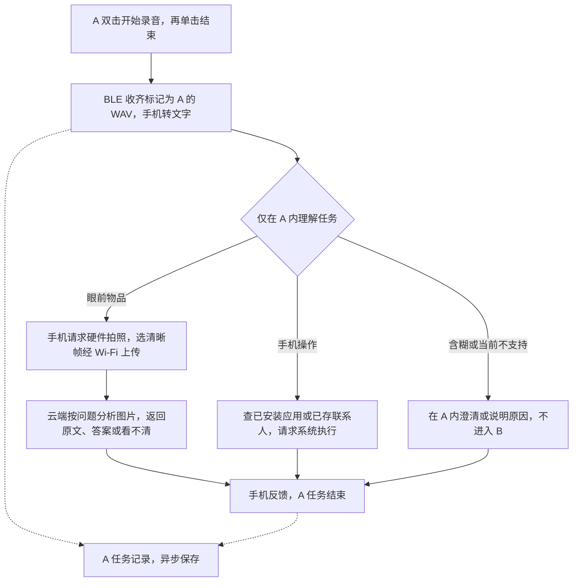
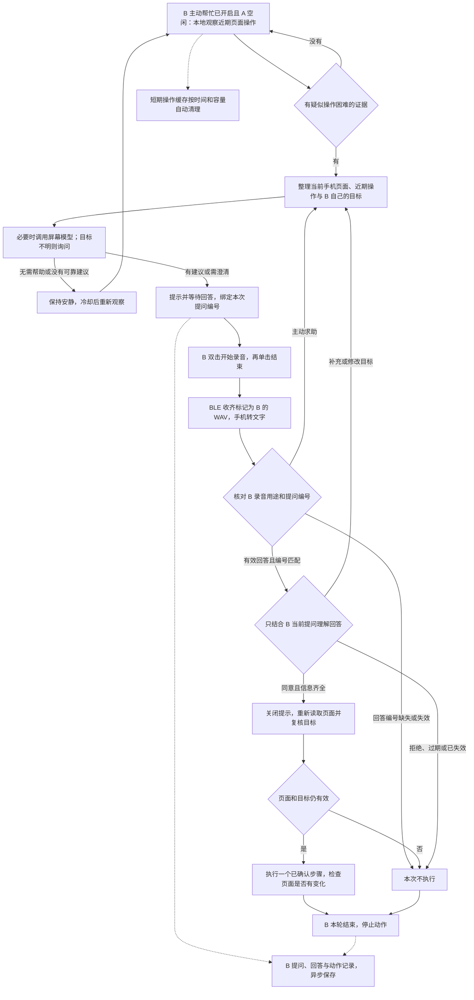

# A / B 双按钮产品工作流程与联调方案

日期：2026-10-23。本文是新路线的产品方案与开发依据，不表示现有 0.6.2 APK 已实现文中全部流程。本轮保留原 APK，不修改源码或重新打包。

产品目标：一个 APK 内有两套独立功能。A 处理用户明确说出的手机指令和眼前实物问题；B 只处理手机屏幕上的操作困难、主动求助与帮助确认。硬件负责按钮、录音和拍照，手机负责接收、转写与动作，云端提供视觉和屏幕辅助推理，数据库保存任务记录。

**录音开始时就按硬件的 A/B 来源固定归属，再分别处理文字。不能先把两类语音送进同一个智能任务分类器。**B 不判断是否需要实物视觉，也绝不启动硬件摄像头。两套功能放在同一 APK，老人首页仍不显示语音或拍照按钮。

## 1. 建议确定的产品规则

1. **A/B 先分开，A 内部再分两类。**A 只判断明确手机操作或眼前实物问答。“帮我看看微信消息”不能因为带“看看”就开硬件摄像头。A 听不明白时在 A 内澄清或结束，不自动转入 B 的屏幕预测。
2. **B 独立处理屏幕帮助。**没有提问在等待时，B 的录音表示“结合现在的页面帮帮我”；已有待确认提问时，B 的录音专门回答该提问。B 中补充的“想和女儿视频”等目标留在 B，不转发到 A。
3. **目标、状态和提问分开保存。**A 不进入 B 的困难预测，B 不继承 A 的任务目标。底层 BLE 接收、WAV 转文字和记录工具可以复用，不需要同时跑两个语音模型；业务判断仍分别进行。
4. **A 工作时暂停 B。**A 开始任务，B 暂停观察、模型分析和提示，作废尚未执行的建议及迟到结果；A 结束，若主动帮忙原本开启，则清掉旧操作缓存、冷却后重新观察。不拿 A 的自动操作作为 B 的困难证据。
5. **自动发现困难不需要老人先说清目标。**用户或家人先启用 B 的“主动帮忙”，系统才在获准的应用范围内观察近期操作。观察到反复操作且页面没有进展，才考虑询问或请求模型。老人也可用 B 主动求助。
6. **先观察轻量事件，必要时才看截图。**不持续录制或上传屏幕视频，不尝试读取其他 App 的私有后台数据库。B 的手机截图与 A 的硬件实物照片是两种不同输入。
7. **推测不能直接代办。**只有有依据且足够明确的建议才提出具体确认问题；没有 B 自己的目标上下文时问“您想做什么”，不能凭空猜测要给女儿视频。
8. **确认后重新看页面，最多执行一步并停止。**用户回答及提示框都会影响页面，执行前必须关闭提示、重新定位真实控件。检查这一步的页面变化，不把“已点一下”当作整个任务完成。本次 Demo 不宣称任意跨 App 多步任务均已实现。
9. **记录异步保存。**A 的明确本地操作、B 的本地检测与确认状态都不以数据库写入成功为前提。云端同学继续使用已有服务和数据库，保存两类任务的结果；云端模型故障时，依赖其推理的步骤仍应明确停止。

## 2. 两条独立产品流程

首次准备相同：连接设备、完成必要授权、选择是否开启 B 主动帮忙。之后在接收入口按硬件按钮标签分别交给 A 或 B，不让模型决定归属。图中的任务箭头不在 A/B 之间跳转。

### A：明确指令与实物问答

### B：手机屏幕困难援助

图中“本地观察”只在主动帮忙开启、A 空闲且相关权限有效时运行。B 本轮结束后若主动帮忙仍开启，清除本轮待执行建议，冷却后恢复新一轮观察。手机转文字失败或权限不足时反馈原因，不把失败强行解释成某个动作。A 的“听不清，请再说一次”仍由 A 处理，不建立 B 的回答状态。

语音收齐、模型请求和录音回答都有会话及任务编号。来源缺失或矛盾时不执行；不能通过句子内容、手机有没有弹窗来猜 A/B。

## 3. 两个按钮怎样工作

两按钮都只使用硬件录音，不需要老人按手机上的语音或拍照按钮。

| 当前状态 | A 的作用 | B 的作用 |
|---|---|---|
| 空闲，没有待回答问题 | 双击开始明确指令录音 | 双击开始屏幕求助录音，可说“我找不到了”“帮我看看下一步” |
| 正在录 A | 单击 A 停止录音并发送 | 不切换录音用途，反馈正在录音 |
| 正在录 B | 不把同一段录音改成 A | 单击 B 停止录音并发送 |
| 等待帮助提问的回答 | 双击 A 取消旧建议，开始一个新任务 | 双击 B 录本次回答，单击 B 结束 |
| 正在传输、识别或执行 | 不叠加第二段任务，反馈忙碌 | 不叠加第二段任务，反馈忙碌 |
| 任务结束 | A 结束；若 B 原本开启，清旧事件并冷却后恢复观察 | B 本轮结束并停止动作；若开启主动观察，冷却后恢复观察 |

建议初始参数：双击间隔 500 毫秒以内，录音最长 15 秒，等待回答 30 秒。它们是联调起点，要按老人实测调整，不是固定性能承诺。双击负责防止误启动；开始录音的第二击不能又被当成“单击结束”，固件要吞掉这一击。

若 B 在提问有效期内开始录音，等待计时可暂缓至这段录音和传输结束，并设置总上限；断开、换任务或提问失效仍立即取消，不能无限续期。

A 优先适用于 B 正在观察、等待模型或等待回答时；同一麦克风已经录音或系统已经接到一次点击时，先结束该段录音 / 当前原子动作，不声称能撤回已发出的点击。之后再开始新任务，不同时执行两条业务流程。

录音开始、录音结束、正在处理、任务完成应有可感知状态。手机可以文字、震动与朗读；硬件至少有灯光或短提示，让老人知道是否真的开始录音。手机开始朗读时不采集自己的播报；用户按键准备说话时先停止朗读。

**B 在本方案中是援助按钮。**此前设想的“双击紧急求助”与此定义冲突，本次不能把同一个 B 双击同时接成报警。紧急求助另设清晰入口，后续再确定独立操作。

## 4. A：明确任务路线

### 手机操作

`录音 → 本地转文字 → 判断动作 → 查真实安装应用 / 联系人 → 执行 → 反馈 → 保存记录`

- “打开某软件”沿用系统真实启动目录，不逐个登记 QQ、抖音等包名。
- “给某人打电话”沿用 App 保存的联系人称呼与号码，不读取通讯录。
- “在某软件里给某人发消息、打视频”是进一步的页面操作能力，不能因为能打开该软件，就算已实现全部功能。
- 后续 A 可增加自己的“读取当前控件 → 从真实候选定位 → 执行 → 验证”能力；不同 App 的控件暴露、登录状态和布局会限制执行，并非任意 App 都能操作。即便复用操作工具，也不进入 B 的主动预测和待回答流程。
- A 任务涉及不同操作能力时在 A 内调度；不认识的话在 A 内澄清或结束，不转成自由点击，也不自动转入 B。

### 实物视觉

`问题文字 → 手机分配任务编号 → 请求硬件拍照 → 采少量候选帧 → 选清晰图片 → Wi-Fi 直传云端 → 按问题分析 → 手机获得同任务结果 → 显示、朗读、震动 → 保存记录`

推荐让 ESP32 摄像头走 Wi-Fi 上传，手机用 BLE 发拍照控制并接收任务状态。图片若必须手机中转，则需另外确认传图接口；不能只收到文件名或 `image_ready` 就认为手机已有图片。

Demo 先一张清晰照片；可从 2–3 张短间隔候选帧中选择 1 张，只有看不清时再补一张。不要连续视频全上传。文字很小时保留足够分辨率，裁剪和压缩以原文可辨为准。

结果至少区分“已识别并回答”“看不清”“未找到对应文字”“失败”。问生产日期、用法用量时，返回对应包装原文与答案；看不到就说无法判断。数据库只记“请求成功”不足以证明答对了。

手机获得结果采用一条确定的通路：推荐由手机按任务编号查询；后端已有推送也可复用。图片在数据库里，不等于手机自动知道已处理完成。

## 5. B：主动援助路线

### 你提供的四阶段思路怎样使用

| 阶段 | 零基础能理解的做法 | Demo 如何实现 |
|---|---|---|
| 采集操作 | 记住最近点了哪里、换了哪个页面 | 无障碍事件加有界临时缓存；不全程录像 |
| 判断困难 | 看是否反复点、来回退却没有进展 | 先用少量本地规则；疑似困难时才请求模型 |
| 澄清意图 | 问“需要帮忙吗？您想做什么？” | B 录音转文字，结合 B 当前问题理解确认、拒绝或补充 |
| 单步帮助 | 讲清下一步，确认后做一下就停 | 重新读取页面，执行一个已确认动作，核对变化 |

这四阶段只属于 B。它们可以使用现成语音和视觉语言模型，不需要团队训练新模型；“视觉语言模型”指能看图片并理解文字的模型，B 给它的是手机截图，不是硬件摄像头照片。

用户材料中的 Mobilerun、GUIDE、KnowU / KnowU-Bench、CVPR 2026 等项目名和归属尚未核实到可靠原始来源。这里采用的是材料所描述的工作思路，不据此承诺论文性能、可用代码或能够直接拼装。

### 先判断是否可能需要帮助

优先使用 Android 无障碍事件与当前页面控件信息。Android 11 及以上可在需要时调用现有截图能力。这里的“后台”指助手服务继续运行，不是读取其他 App 私有服务器、数据库或密码。

本地只保留近期轻量事件，例如当前软件、页面摘要、点击目标标识、页面是否变化和时间。推荐先保留 30–60 秒、最多 100 条，时间和数量哪个先到就清理哪个。

可作为触发线索的例子：10 秒内同控件重复点击 3 次且页面没有进展、短时间在相同两个页面往返多次。缓慢操作、正常阅读或网络等待本身不证明“老人迷路”。这些规则先筛选是否值得请求模型，不直接决定用户目标。

现版只记录 CLICK / SCROLL / WINDOW_CHANGE 等信息，仍需补充目标标识和页面摘要；不能把所有窗口变化都当成“返回键”。页面目标不存在、控件不可读或页面持续加载时，不强行推断动作。

### 模型给出建议，用户来决定

云端收到：近期事件摘要、当前页面可操作控件、必要的一张截图、用户在 B 当前任务中明确表达的目标。没有 B 目标时就留空，不读取 A 的任务目标。返回一条帮助建议、一个澄清问题或无需打扰。

“达到一定可能性”建议实现为：有本地操作困难线索、模型建议与当前真实控件相符、目标信息足够、分值通过内部阈值。模型自己返回的 `confidence` 不等于经过验证的成功概率，不能把它说成“85% 一定正确”。阈值需用实测样例调整。

- B 当前任务已明确有“联系女儿视频”的目标，才适合问“您刚才是想和女儿视频吗？”
- 没有这个证据，问“需要帮忙吗？您想做什么？”
- 同一个困难过程最多保留一个提问；拒绝或超时后进入冷却，建议先 60 秒，避免不停打断。
- “不用再提醒”可暂停主动提醒；“不用了”取消本次。主动帮忙的关闭入口始终保留。

### B 口语回答按当前提问理解

| 口语例子 | 处理 |
|---|---|
| “对”“嗯，就这样”“帮我弄一下” | 信息已齐全时确认本次建议 |
| “不用了”“算了”“停一下”“别点” | 取消本次，不执行 |
| “对，和我女儿” | 确认并补充对象，缺少联系人对应关系时仍要定位或追问 |
| “不是女儿，是儿子” | 修改目标，不沿用旧对象执行 |
| “嗯……”“你说啥”“我不知道”或听不清 | 不当成同意，简短重述或结束 |

否定、纠正优先于句中的“对”“好”。取消、修改对象等不得只靠某个单字匹配。补充的“女儿”称呼也不能自动等于 QQ/微信中的某个账号；电话联系人和应用好友的对应关系是不同数据。

确认后：关闭本 App 提示，重新读取目标软件、窗口及控件。页面仍匹配才做一个步骤，再检查是否出现预期变化。换页或用户已经自行完成时，旧建议失效，后到的云结果 / 录音不得补执行。

B 中收到“想和女儿视频”只是补充 B 的屏幕任务目标，不调用 A 的指令入口，更不启动硬件摄像头。确认“我想做什么”也不等于授权任意点击：系统还需知道当前一步做什么；不明确时先讲清或询问，不自行连续操作。

跨 App 提示推荐复用无障碍服务的可访问提示层，避免为 Demo 再叠加独立“悬浮窗权限”；能否显示、朗读和获得回答都须在比赛用手机验证。

## 6. 当前 APK 能保留什么，还需要增加什么

| 部分 | 0.6.2 当前情况 | 新路线工作 |
|---|---|---|
| 视觉首页、App 内联系人、文字与震动反馈 | 已有 | 保留，不增加老人语音 / 拍照按钮 |
| BLE WAV、本地离线转写、动态打开 App、直接拨号 | 已有，尚需真机联调 | 增加 A/B 来源、任务关联、后台会话 |
| 记录本机保存、可选后端同步 | 已有 | 与新云端事件接口对齐 |
| 无障碍事件、控件树、截图、单步候选预测 | 已有可复用代码，默认可选 | 增加主动困难检测和待回答流程 |
| A 实物问答闭环、手机朗读 | 未完成 | 对接拍照、云视觉、结果查询和手机 TTS |
| B 主动提问、口语确认、跨 App 持续收音 | 未完成 | 新增任务状态与确认绑定、服务、执行前复核 |
| 真实任意 App 内多步代办 | 未实现保证 | 通用引擎逐步验证，按当前页面能力执行 |

最关键的工程缺口：现有 BLE / ASR 主流程绑定首页，离开首页后的结果会被阻止执行。新路线要把它迁到持续运行的服务或等效稳定组件，并保留运行通知和生命周期管理。不能简单删除“前台检查”就当后台能力已经完成；要同时检查解锁、会话是否有效、提问是否过期、用户是否已取消。

基础 A 打开软件不需要无障碍；B 屏幕观察、跨 App 帮助需要用户在系统中开启无障碍等相应能力，家人可先设置。系统授权不能由助手代点。Android 11+ 真机优先用于本次屏幕援助 Demo。

给开发者的模块边界：`ACommand` 只接 A；`BScreenAssist` 只接 B 与 B 的操作事件；`DeviceIO` 只负责设备连接与带标签的收发；`SpeechTools` 只负责转写与朗读；`RecordStore` 只负责保存。它们是建议的逻辑职责，尚非已经实现的类名。A/B 各有自己的任务状态，底层工具不替业务猜用途。

## 7. 如何减少延迟

- 连接成功后预加载一次语音模型，不等第一段 WAV 才解压 / 初始化；把“模型准备好”显示出来。
- 固件确认结束后立刻传 WAV；协商可用 MTU、批量传输节奏，收包回调不做重计算。先实测吞吐，避免只优化模型。
- 16 kHz、单声道、16 bit PCM 每秒约 32 KB；5 秒录音约 160 KB。实际 BLE 若只有 20 KB/s，单传文件就约 8 秒，忽略其他开销也做不到“立刻”。这个数字是计算例子，不是本设备实测速率。
- 本次先保留 WAV 路线，限制短句，避免第一天再增加编码器、另一套流式识别。若实测传输仍是瓶颈，再决定压缩或边录边传，双方一同改。
- 摄像头只在任务需要时拍，短时采少量清晰帧，用 Wi-Fi 传图片；云端按问题回答，不先跑无关的全功能分析。
- B 本地先筛选疑似困难，不每次点击都请求模型，也不持续上传全屏视频。
- 记录落库异步进行；只读网络失败不阻塞本地明确指令。
- 各段记录时间：录音结束、WAV 收齐、转写完成、拍照完成、上传完成、云端返回、提示出现、动作完成。用测量结果判断优化哪段，不预先承诺总延迟。

## 8. 云端和数据库的边界

| 服务 | 接收 | 返回 / 保存 |
|---|---|---|
| 实物视觉 | 本次问题、图片、任务编号 | 包装原文、答案、看不清 / 失败状态 |
| 屏幕帮助推理 | 近期操作摘要、当前控件、必要截图、已有目标 | 帮助建议、提问、候选引用、分值与依据 |
| 任务事件存储 | 转写、任务类别、用户确认 / 取消、动作结果与耗时 | 按唯一记录编号去重、确认保存 |
| 媒体临时存储 | 为本任务保留的必要图片 | 返回媒体编号 / 地址，按约定清理实际文件 |

B 的即时检测、提问和确认可以只用手机短期缓存，不必先查数据库，也不需要从历史数据库猜老人意图。这不取消整个产品的云端数据库：A 的问答记录、B 的帮助结果及原有同账号历史查看仍可异步同步；同步失败按记录编号重试，不能重做手机动作。

短期页面历史放手机有界内存，不把全程观察记录入库。默认不长期保存原始屏幕，传云后的临时截图可建议 10 分钟后删除；任务文字摘要是否保留、保留多久由产品和后端统一确定。照片如需展示历史，另设保留期限；数据库行和对象存储中的图片要同时清理，不能只删一边。

服务接口、超时、任务编号与失败格式见 [A-B 接口对齐草案](A-B接口对齐草案.md)。它们是新路线待实现的约定，不改写 0.6.2 的既有协议。

## 9. 六小时 Demo 的完成标准

至少跑通三个真实闭环：

1. **A 手机任务：**实体按钮录音，手机转文字，动态打开至少两个不同已安装软件，再按 App 内联系人请求拨号。不能把手机文字测试冒充 WAV 全链路。
2. **A 实物问题：**实体录音提问、实际拍照、真实云端分析、手机显示并朗读、云端存在关联记录。换一张照片或换个问题，结果应随输入变化。
3. **B 帮助：**在真实页面的疑似困难操作引出帮助提问，实体 B 回答“对”后重新看页面并执行一步；再测“不用了”确实不执行。模型根据实际页面与目标工作，不把女儿视频例子写死。

B 可同时提供按 B 主动求助作为可用入口；若只有手动求助成功，验收写“手动求助已完成，主动发现未完成”。App 内练习页面可用于定位问题，展示时必须标明练习；收到 BLE、数据库有行或返回模型 JSON 都不是单独的闭环完成标准。

必须再做三项隔离检查：A 语句含糊时不进入 B；A 执行时 B 不弹帮助提示且旧建议失效；B 回答“想和女儿视频”仍留在 B，不转 A 或启动硬件相机。相同文字分别从 A/B 输入，也应按各自用途处理。

### B 的效果先怎样记录

准备至少 3 段确实遇到困难的操作和 3 段正常操作，用于联调找问题，不把这个小样本当成统计证明。每次记录是否主动提示、用户是否接受、是否做对一步、最后是否完成目标及耗时。

| 指标 | 最简单的记录办法 |
|---|---|
| 帮助是否有效 | 已接受的帮助中，有多少次实际推进了用户目标；另记询问是否帮用户说清目标 |
| 误打扰 | 正常阅读、正常操作或等待时，出现了多少次不需要的提示 |
| 单步可靠性 | 确认后是否定位正确、页面是否有预期变化、是否确实停止 |
| 最终完成目标 | 老人最后是否完成了本来要做的事；不要只记模型猜中了什么 |
| 等待时间 | 疑似困难到询问、录音结束到转写、确认到动作各用了多久 |

四人职责和 5–6 小时冲刺门槛单独见 [分工参考](四人六小时联调分工_参考.md)。六小时目标是这些闭环可重复运行，不是六小时保证完成任意应用、任意多步任务。
