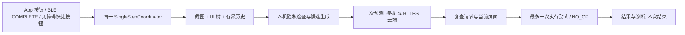

# NextAction 架构与联调（0.6.0）

> 本文对应 0.6.0 新增的 NextAction。0.5.0 的构建、lint 和 39 项测试是既有基线，不等于新增能力已通过真机验证。后文区分电脑验证和手机待验证；最终以本文的验证记录为准。

## 1. 先理解这次增加什么

原来“打开抖音”“给女儿打电话”的路径继续保留：硬件 WAV 在手机离线转文字，匹配明确指令后执行，后端只存文字记录。NextAction 是同一个 APK 内新增的一项独立能力：用户主动触发一次，手机观察当前页面和最近的有限操作历史，让模型从手机给出的候选中选一个安全的下一步，手机复核后最多尝试一次，然后停止。

它不会接管整个任务。例如练习页上有“测试下一页”按钮，本次可以只点这一个按钮；不会自动继续找下一页、再次调用模型、替你完成整个流程。条件不足时 `NO_OP`（不操作）也是正常结果。



## 2. 现有工程审查与保留范围

本次先检查现有工程，再按原生 Kotlin 风格增量接入；没有另建 Android App，也不引入 Flutter、数据库队列或多智能体框架。

| 项目 | 基线事实与复用方式 |
|---|---|
| Android 技术栈 | 原生 Kotlin，程序式 `Activity` 页面；Gradle Kotlin DSL，JDK 17；minSdk 26、targetSdk 34、compileSdk 35 |
| 现有依赖 | 本地 Vosk Android 0.3.47、JNA 5.13.0；不替换离线语音模型 |
| 现有 BLE | `BleClient` 负责连接/订阅/回写，`BleIncomingStream` 兼容原始 WAV 与 JSON，`DeviceEvent` 解析事件；新增 `COMPLETE` 复用此连接 |
| 现有语音 | `WavPcmReader → OfflineSpeechClient → TranscriptCollector → CommandParser`；继续支持完整 WAV 离线转写、准确称呼拨号、抖音启动 |
| 现有存储 | `BackendSync` 的 SQLite 事件 outbox 与原来的记录接口保留；不拿它存截图或模型密钥 |
| 网络方式 | 已有 `HttpURLConnection`；NextAction 沿用轻量后台网络风格，预测端点与事件存储分开 |
| Android 系统能力 | 基线没有 AccessibilityService 或后台服务；新增专用无障碍服务，旧 BLE 不因此变成有后台保活保证 |
| 界面管理 | 保留 `HomeActivity`；新增设置和练习页面，避免把调试弹窗盖在待分析页面上 |
| 原有权限 | BLE、电话、可选手机麦克风、联网、震动保留；NextAction 的无障碍启用与屏幕上传同意独立设置 |
| 已有验证 | 0.5.0 assemble、lint、测试编译通过，39 项纯 JVM 测试通过；0.6.0 新增验证单独记在最后一节 |

### 文件地图

下表对应本版实际新增文件和集成位置。

| 位置 | 职责 / 以后要改什么就看哪里 |
|---|---|
| `app/src/main/java/cn/seniorvoice/demo/HomeActivity.kt` | 增加 NextAction 设置入口和 BLE `COMPLETE` 分流；保留原 WAV、联系人、电话、抖音流程 |
| `app/src/main/AndroidManifest.xml` | 注册无障碍服务、设置页面、练习页面；服务由系统绑定，不能作为普通外部组件随意启动 |
| `app/src/main/res/xml/next_action_accessibility.xml` | 无障碍能力与事件声明，包括读窗口内容、截图/手势能力；实际支持由 Android 版本和设备决定 |
| `app/src/main/res/values/next_action.xml` | 服务名称、说明及练习根节点 ID 等资源 |
| `…/nextaction/NextActionRuntime.kt` | 连接服务、持有当前会话同意、配置预测器、转发状态；保存配置和服务断开会撤回本次同意 |
| `…/nextaction/trigger/` | `AppButtonTrigger.kt`、`BleTriggerAdapter.kt`；App 倒计时和 BLE 触发均调用同一流水线，系统快捷入口也由 Runtime 汇合 |
| `…/nextaction/observation/` | `NextActionAccessibilityService.kt`、`AccessibilityBridge.kt`、`ScreenSnapshotter.kt`、`UiTreeParser.kt`、`InteractionHistory.kt`、`PrivacyFilter.kt`；节点深度/数量与历史有上限 |
| `…/nextaction/domain/DomainTypes.kt` | 版本化协议与快照、候选、决策、历史、结果数据类型 |
| `…/nextaction/domain/ActionPolicy.kt` | 导航类动作白名单与密码/支付/发送/提交/删除/拨号等拒绝规则；旧显式语音拨号不走此 Agent 策略 |
| `…/nextaction/domain/CandidateGenerator.kt` | 仅由当前真实节点生成临时候选，不能自由创造控件 |
| `…/nextaction/domain/TargetResolver.kt`、`ExecutionGate.kt` | 执行前重新定位、页面/请求/候选/风险复核 |
| `…/nextaction/domain/SingleStepCoordinator.kt` | 有锁的单步状态机、去抖、超时、取消、一次执行边界；领域层与手机 UI 解耦 |
| `…/nextaction/network/` | `AgentApiClient.kt`、`AgentJson.kt`、`MockPredictionService.kt`：HTTPS 请求、超时、严格协议及本机模拟；不接收 OpenAI API Key |
| `…/nextaction/execution/AccessibilityActionExecutor.kt` | 目标重新定位与 Android 节点/手势/返回操作；单次失败不坐标兜底重试 |
| `…/nextaction/diagnostics/AgentSettingsActivity.kt` | 启用、模拟/云端配置、会话同意、当前状态、内存诊断与关闭入口；不落盘原始截图、节点正文或个人内容 |
| `…/nextaction/diagnostics/AgentPlaygroundActivity.kt` | 本 App 内无敏感内容的练习页，用本地模拟预测验证一次点击和随后 NO_OP |
| `agent_backend/` | 新增轻量 Python 预测服务、结构化 schema、供应商适配与测试；与旧 Node 事件服务独立 |
| `app/src/test/…/nextaction/` | 状态、候选、敏感策略、请求编号、页面变化、超时、无效响应与一次执行测试 |

现有 `README.md`、`docs/接口约定.md` 和 0.5.0 安装说明继续说明旧功能；本文补充 NextAction，不把旧版记录接口改成预测接口。

## 3. Android 版本、权限和使用前提

| 能力 | 条件 |
|---|---|
| 安装 App、旧 WAV/电话/抖音功能 | Android 8.0（API 26）及以上，具体旧功能按原说明授权 |
| 本版 NextAction 截图 | Android 11（API 30）及以上，使用用户开启的 `AccessibilityService.takeScreenshot` |
| Android 8–10 | 本版不实现此截图路径，NextAction 明确提示不支持；原有功能照常可用 |
| 读取当前控件与执行节点动作 | 用户主动在系统设置开启本 App 的无障碍服务，在 App 内启用并保存 NextAction 配置，再勾选本次会话同意 |
| 真实云端预测 | 本次会话同意还涵盖屏幕信息上传，需配置有效 HTTPS 预测地址；默认不开启 |
| 模拟练习 | 也需同意本次页面采集；仅在本 App 专用练习页面执行，不上传屏幕，不需要云端 API Key |

系统保护画面、密码页面及已识别的敏感场景应拒绝采集/上传或返回 `NO_OP`，不能绕过 Android 的安全屏幕限制。App 不会假造截图或空节点来继续执行。隐私过滤是 Demo 的保守规则，不能声称能自动识别所有第三方 App 的所有敏感画面；真实测试先用无私人内容的普通页面。

新增无障碍能力用于内部 Demo，不代表已满足应用商店发布政策。用户可以随时关闭 App 内 NextAction、取消本次会话同意，或去系统关闭服务。关闭/取消后，旧请求的迟到结果不能执行。会话同意仅在内存保留；保存配置、服务断开或进程重启后须重新勾选。取消同意会立即取消当前任务并清空近期历史。

## 4. 把新版安装到手机并开启服务

以下按钮名称对应本版页面；系统授权路径在不同品牌手机上略有差异。

1. 将项目根目录的 `语音生活助手_0.6.0_安卓安装包.apk` 发送到 Android 手机，通过“文件管理”打开安装。本版版本号 0.6.0、versionCode 8。保持同签名更新，先不要卸载，避免清除原有联系人、设置和本机记录。微信限制 APK 时发送 `语音生活助手_0.6.0_微信传输备用.zip`，解压后安装 APK。
2. 打开 App，先检查原有联系人和 BLE 设置仍在。旧电话测试会直接拨号，使用测试号码；不必为了测试 NextAction 重新拨一次电话。
3. 从首页点“AI 补全设置 / 调试 / 安全练习”，进入“AI 单步补全 · 内部 Demo”。勾选“启用 AI 单步补全”和“模拟模式（只操作 App 内练习页，不上传）”，点“保存配置（保存后重新勾选本次同意）”。模拟模式下地址和服务令牌可以留空，不填写 OpenAI API Key。
4. 点“打开系统无障碍设置（需你主动开启）”，找到本 App 对应服务，由本人阅读系统说明并主动开启。系统若提示“受限制的设置”，应按自己手机对侧载 App 的正常设置路径处理；本 App 不绕过系统限制。
5. 回到设置，确认“无障碍连接：true”，再勾选“我已了解：同意本次会话读取页面和近期操作；云端模式还会上传当前屏幕。取消勾选立即停止。”确认“本次同意：true”。功能已保存启用、系统服务连接、本次同意三项缺一不可；模拟模式同样需要同意本地采集。
6. 可在系统为该服务分配无障碍快捷按钮/快捷方式；是否可用取决于系统界面。快捷触发和 App/BLE 使用同一流水线，不打开调试弹窗后再抓屏。
7. 首轮只进入 App 内练习页面做模拟测试。保持手机解锁；本项目不承诺后台常驻、锁屏控制或 BLE 断线自动重连。

“3 秒后补全一次（立即切换到目标测试页面）”和练习页的“3 秒后模拟补全一次”均延后 3 秒再开始观察。设置页包含输入框，不能停留在那里等待抓屏；应在倒计时中切换到无个人内容的目标测试页。BLE 和系统无障碍快捷按钮立即触发，没有这 3 秒倒计时。**可以在倒计时阶段切换；进入采集/预测后再改变页面，会取消旧请求。**

## 5. 无服务器的模拟练习

模拟模式是第一步验证，不等于云端模型已经理解页面。模拟预测固定寻找本 App 练习页上标签为“测试下一页”的合法 TAP 候选，找不到就选 NO_OP，不能拿它驱动微信、支付或其他第三方 App。

1. 按上一节先启用并保存模拟模式、连接无障碍服务、勾选本次会话同意。练习按钮的名称不会替代设置：若已保存的是云端模式，它仍会调用云端预测器。
2. 点“打开安全练习页（模拟单次点击）”，确认页面显示“AI 单步安全练习”“已点击次数：0”和“测试下一页”。不要手动点击“测试下一页”，以免把人工操作当成 AI 验证。
3. 点“3 秒后模拟补全一次”，等 3 秒后保持页面不动。预期模型选择 TAP，“已点击次数”变为 1，目标变成禁用的“本次练习已完成”。之后应停止，不能继续点击其他按钮。
4. 再点一次“3 秒后模拟补全一次”。预期没有合法练习目标，返回 NO_OP，次数仍为 1。
5. 点“返回 AI 设置”，查看来源、候选、选择、结束原因、耗时和执行结果。最终 IDLE 状态保留本次结束原因，不需要在采集时打开诊断弹窗。
6. 要重做，返回练习页点“重置练习页面”，次数恢复为 0。模拟层仅允许 TAP 或 NO_OP，不会为滚动、返回或第三方页面编造动作。
7. 单独验证取消：倒计时时点“取消当前请求”，或在预测中切换页面、撤回同意/停用功能，旧结果不得执行。快速连续触发应被倒计时限制、去抖或拒绝为忙碌，不应出现两次点击。

模拟还要求当前包名是本 App，且有可见、启用、`viewId` 为 `cn.seniorvoice.demo:id/next_action_practice_root` 的练习根节点；仅仅同包名不足以授权模拟操作。一次滚动和一次返回另由领域测试及真实预测/执行的现场步骤验收，不把模拟点击当作这两项已验证。电脑领域测试与手机节点执行测试在最后验收表中分别记录。

## 6. 真云端预测：服务器准备与 HTTPS

### 三个接口不要混填

| 功能 | 地址 / 负责内容 |
|---|---|
| 旧图片视觉 | `http://192.168.1.17:8000/analyze`，朋友已有 `image + intent` 图片接口；原样保留 |
| 旧文字记录存储 | 朋友实际事件 URL；项目自带 Node 演示为 `http://电脑IP:8787/v1/events`；只保存旧文字事件 |
| 新 NextAction 预测 | `https://你的有效HTTPS域名/api/v1/next-action/predict`；只预测一次候选动作，不直接操控手机 |

新版不能把 `http://电脑IP:端口` 填进真实预测地址来代替 HTTPS。手机连接自己的 Python 服务；OpenAI Key 只留在这台服务器环境变量，不放 Android 源码、APK、手机设置或 BLE 消息。

### Python 启动

以下是已落地后端的启动入口，后端可单独从 `NextAction_后端源码与说明.zip` 取得。当前开发环境尚缺 FastAPI/uvicorn，依赖安装受网络审批连接故障阻断；不能据此声称 HTTP 服务或云端调用已经成功。后端自己的详细说明见 `agent_backend/README.md`。

```powershell
# 从项目根目录进入新增后端；仅创建它自己的虚拟环境
Set-Location agent_backend
python -m venv .venv
.\.venv\Scripts\python.exe -m pip install -r requirements.txt

# 先用服务端 Mock 验证协议；只返回 NO_OP，不调用云模型
$env:VISION_PROVIDER = 'mock'
$env:REQUEST_TIMEOUT_SECONDS = '15'
$env:ENABLE_DEBUG_LOGGING = 'false'

.\.venv\Scripts\python.exe -m uvicorn app.main:app --host 127.0.0.1 --port 8788 --no-access-log
```

本机启动后按 `Ctrl+C` 停止，设置真实模型环境再重新启动：

```powershell
$env:VISION_PROVIDER = 'openai'
$env:OPENAI_API_KEY = '<仅在自己电脑本地设置，不要发给别人>'
$env:VISION_MODEL = '<支持图片与结构化输出的实际模型名>'
# 可选：保护你自己的预测端点；和 OpenAI Key 是两种不同凭据
$env:AGENT_API_TOKEN = '<你给本项目预测服务设置的令牌>'
.\.venv\Scripts\python.exe -m uvicorn app.main:app --host 127.0.0.1 --port 8788 --no-access-log
```

需要 Python 3.10 或更新版本；上面直接调用虚拟环境的 Python，不需要运行激活脚本。`.env.example` 只是示例，服务不会自动加载 `.env`，修改环境变量后需重启服务。启动后可在服务器本机访问 `http://127.0.0.1:8788/health`，这一步成功才说明本机 HTTP 入口已启动。

没有配置服务鉴权时不要原样设置示例 `AGENT_API_TOKEN`；真正配置后，在手机“服务访问令牌”输入同一个值，由客户端以 `Authorization: Bearer ...` 发送。OpenAI Key 仍只在 Python 环境，手机输入框会拒绝 `sk-` 开头的密钥。不要把示例里的尖括号内容原样当作可用配置，也不要把密钥贴进聊天或提交仓库。模型名称从环境读取，不写死在 Android。没有真实密钥、额度或对应模型权限时只能验证模拟/结构，不可称云端已跑通。

**App 内模拟**会在练习页面选 TAP/NO_OP；**Python 服务端 Mock**固定返回 NO_OP，只验证 HTTPS/协议，不用于演示自动点击。两者不要混淆。

Python 默认仅监听本机 8788，由具有有效证书的 HTTPS 反向代理转发。项目提供 `agent_backend/deploy/Caddyfile.example`，按自己的域名、DNS 和证书条件配置；域名必须能到这台代理。部署与防火墙按实际服务器处理，不能把示例域名当成现成服务。手机必须正常信任证书，不关闭 TLS 校验，不使用接受所有证书的调试代码。

### 手机连接

1. 在手机浏览器访问 `https://自己的域名/health`，确认网络可达、证书有效。开发电脑访问成功不代表手机可达。
2. 在 NextAction 设置填完整 HTTPS 预测 URL，按需填本服务访问令牌，取消“模拟模式”，保持“启用 AI 单步补全”，点“保存配置（保存后重新勾选本次同意）”。预测 URL 不是旧首页里的记录存储地址。
3. 保存后重新阅读并勾选本次会话同意。云端模式会上传屏幕信息；保存配置、服务断开或进程重启都会撤回这次同意。取消勾选立即取消当前请求并清空近期历史。
4. 先用无私人内容的练习页面触发一次，保持网络和页面稳定。返回诊断后确认本次只有一条预测、最多一次动作尝试。
5. 再以不涉及账号、支付、消息发送、删除或提交信息的普通页面测试。遇到敏感拦截或候选不足，接受 `NO_OP`，不要靠放宽策略强行自动执行。
6. 不测时取消本次会话同意；要彻底停用，点“停用 AI 并关闭此无障碍服务”。旧电话/WAV 功能无需启用这项云端能力。

上传内容包含 JPEG 截图、经筛选的 UI 信息、近期有意义的操作历史与候选列表；历史最多 20 条，仅记录点击/滚动/窗口变化的类型、包名、窗口、序号和时间，省略事件文字，400 毫秒内相同类型/包名/窗口的重复事件忽略。历史留在会话内存，服务关闭会清理，不要求数据库。

即使 UI 文字已过滤，截图仍可能含个人内容，因此用户同意和敏感画面拒绝采集必须在网络前生效。当前保守规则会拒绝可见输入框、密码、已识别的个人信息/敏感文字及若干敏感应用，不收集输入草稿。手机/服务不默认持久化原始截图；诊断只保留有界、必要的元数据与结果。界面文字检测不能可靠覆盖图片中的所有私人内容，不能替代用户判断和授权。

## 7. BLE COMPLETE：与 App 同一条路径

继续使用现有 BLE 连接和 UART UUID。ESP32 不需要把截图发到手机，触发消息只表达“现在预测一步”。`BleTriggerAdapter` 接受以下两种格式，优先使用专门的 `complete` 类型：

```json
{"v":1,"type":"complete","id":"complete-0001","text":"COMPLETE"}
```

也兼容原有 command 类型，`text` 去掉首尾空白后必须精确为大写 `COMPLETE`：

```json
{"v":1,"type":"command","id":"complete-0002","text":"COMPLETE"}
```

每次人为触发使用新的 `id`；如果只是重发同一次事件，保持相同编号，避免变成新的触发。消息按现有 BLE MTU 分段，建议完整 JSON 后加换行。也应在不接硬件时保留 App 按钮与练习入口，证明软件闭环。

手机收到后立即进入统一触发/去抖机制，不先弹出确认或调试对话框；否则截图会被 App 自己的界面污染。HomeActivity 集成会按现有 Write 通道回 JSON：接收并提交返回 `ack / agent_started`，不满足条件返回 `ack / agent_rejected`，同一事件编号重传返回 `ack / duplicate`。结束时返回 `result / agent_attempted`（发生过一次执行尝试）或 `result / agent_finished`（没有执行尝试）。其中 `type / status` 是回包字段组合，其他公共字段沿用旧 BLE 协议。

`agent_started` 仅表示已提交，`agent_attempted` 仅表示尝试过；都不证明目标 App 已完成预期动作。具体 NO_OP、取消、失败或系统接受结果在 AI 设置诊断面板查看。当前 BLE 断开会取消 BLE 来源的单步请求。

蓝牙路径与截图路径的生命周期不同：无障碍服务在系统中连接，不代表旧 `HomeActivity` 的 BLE 永久常驻。必须维持当前 BLE 会话可用；本版不新增后台保活保证。若切换 App 后实际 BLE 不再可用，可先用 3 秒 App 触发或系统无障碍快捷按钮完成无硬件 Demo，再现场处理生命周期问题，不能伪称眼镜已联通。

## 8. 协议、状态机与执行约束

### 预测请求/响应

请求的 `schema_version` 是整数 `1`，`request_id` 和 `capture_id` 为不同的 UUID；还有 `package_name`、`window_id`、`captured_at_ms`、64 位十六进制 `ui_fingerprint`、`screenshot`、`ui_nodes`、`history`、`candidates`。JPEG 放在 `screenshot.jpeg_base64`，同时带 `mime_type: "image/jpeg"`、真实 `width` 和 `height`。服务校验 JPEG 头和尺寸，不接受随意字符串。

服务端限制请求正文最多 2 MiB、JPEG 解码后最多 1 MiB、每边最多 4096 像素、最多 160 节点/40 候选/20 历史。候选 ID 唯一，并且恰有一个 `NO_OP` 候选。TAP/滚动目标的 `node_key`、类型、viewId、bounds 必须与本次 UI 节点一致，且实际节点可见启用、支持该动作；BACK/NO_OP 不带节点目标。请求校验失败不能调用模型继续猜。精确字段见 `agent_backend/app/schemas/observation.py` 和 `prediction.py`。

响应回显两种编号，包含 `decision.action`、`candidate_id`、`confidence`、`reason`。候选 ID 是本次快照生成的临时 ID，不是模型自由创造的控件编号。以下为响应形状示例；编号与候选必须来自实际请求，不要把示例当成可直接执行的指令：

```json
{
  "schema_version": 1,
  "request_id": "50630cfe-38e6-439a-9abd-885752fb2f31",
  "capture_id": "26ed3161-c4b3-401a-b981-a72375b3af02",
  "decision": {
    "action": "TAP",
    "candidate_id": "当前候选列表里的编号",
    "confidence": 0.86,
    "reason": "选择此候选的简短理由"
  }
}
```

动作集合仅为 `TAP / SCROLL_UP / SCROLL_DOWN / BACK / NO_OP`。模型不能输入任意坐标、输入文字、创建控件、执行 shell 或调用手机工具。首版不增加自动文字输入、支付、发送消息、提交敏感表单或删除。

模型输入把页面文字视作不可信内容；网页/UI 中的“忽略规则”“改成点击支付”等提示不能修改系统约束。模型没有最终任务目标时不猜测整个任务，多解/上下文不足时选 `NO_OP`。非 NO_OP 决策置信度低于 0.75 时拒绝执行；达到阈值也仍须通过本机策略，不能代替页面和目标复核。

### 一次触发如何结束

```text
IDLE → CAPTURING → PREDICTING → VALIDATING → EXECUTING → FINISHED → IDLE
           任意失败 / 取消 / 超时 ─────────────────────→ FINISHED → IDLE
```

单个有效任务持锁。领域层采用 750 毫秒触发去抖、20 秒任务有效期；重复/快速触发被去抖或拒绝为忙碌。超时后清理状态，迟到回调不得执行。每个 `request_id` 最多一次模型决策，最多一次动作执行尝试；失败也不自动换动作、不补点坐标、不再次询问模型。成功后也立即结束。截图等待最多 3.5 秒，客户端连接超时 3.5 秒、读取超时 17 秒，后端预测超时默认 15 秒；这些分项上限不能延长领域任务的 20 秒有效期。

首版领域对象限定最多 160 个节点、40 个候选、20 条历史，树遍历另有深度限制。仅开放可识别为安全导航的节点；密码、支付、发送、提交、删除、拨号等敏感动作在 NextAction 内拒绝。旧版“给已保存联系人打电话”是用户明确发出的语音指令，继续走原有直接拨号流程，不因 Agent 的推测去发起电话。

执行前重新读取页面与目标，检查请求编号、capture、有效期、取消状态、包名、窗口、关键 UI 指纹、目标可见/启用/可操作状态及本地风险规则。任一不符则 `NO_OP` / 明确错误。目标重新定位失败也停止，不能凭旧截图猜坐标。

TAP 优先 `AccessibilityNodeInfo.performAction`；滚动走实际可滚动目标/手势能力，返回走系统操作。一次调用未成功，不代表可以再尝试另一条路径。“已提交操作”也不等于目标 App 已完成用户意图；诊断应区分请求提交、拒绝、失败和不确定，不把不确定当作成功。

## 9. 调试时看什么

设置页下方的诊断展示最近触发来源、当前状态、包名、近期有界交互历史、候选摘要、模型所选动作、简短理由、全流程耗时、单次预测调用耗时、执行结果和失败原因。预测没有完成时不虚构预测耗时。任务结束后回到 IDLE，仍保留本次真实结束原因。调试查看不参与预测，不自动再触发一次模型调用；“系统接受”仅指 Android API 接受操作请求。

| 现象 | 检查方向 |
|---|---|
| 提示服务未连接 | 系统无障碍服务是否启用、是否被系统关闭；回 App 看真实连接状态 |
| Android 版本不支持 | 本版截图需要 Android 11+；旧 WAV/电话路径仍可测试 |
| 尚未同意本次屏幕采集 | 模拟和云端都要先保存启用配置，再勾选本次会话同意；保存配置、断开服务或重启会重置同意 |
| 配置已勾选却仍提示未启用 | 点“保存配置（保存后重新勾选本次同意）”，仅勾选开关不会立即保存；保存后重新同意 |
| 截图失败/安全窗口 | 系统禁止、设备不支持或敏感画面；保持不操作，不绕过限制 |
| 节点为空/无候选 | 目标页面不暴露可操作节点或被过滤；`NO_OP` 是有效降级 |
| HTTPS/证书错误 | 检查手机可达域名、证书信任、代理路由；不要关闭证书验证 |
| 后端无密钥/模型不可用 | 检查 Python 环境变量和真实账户权限，不把 Key 填入 APK |
| 返回无效编号/未知动作 | 后端协议或模型结果未通过校验；手机不得执行，查服务器结构化错误 |
| 页面已变化/目标消失 | 用户/动画/跳转改变快照，旧请求应结束；重新手动触发，不自动重试 |
| 忙碌/重复触发 | 等本次结束；检查是否同一 BLE 消息反复发送，别换新 ID 制造新任务 |
| 有预测但没有点击 | 看 `NO_OP`、策略拦截、置信度/过期、目标状态、执行器结果；不等于一定是权限不足 |
| 点击后没有下一步 | 这是预期：每次触发最多一步，再次操作需要用户重新触发 |

## 10. 验收矩阵与真实验证边界

本版 Android `assembleDebug`、`lintDebug`、`compileDebugUnitTestKotlin` 已实际成功；`scripts/test-ble.ps1` 运行 68 项 JVM 测试全部通过，包含原 39 项和新增 29 项。新增部分为 `SingleStepCoordinatorTest` 16 项、`ActionSafetyTest` 5 项、`AgentProtocolTest` 8 项，包含预测与总耗时分离的成功/异常测试。lint 结果为 0 错误、24 警告。APK v2 签名验证通过，与旧包签名一致；版本为 0.6.0、code 8，支持四种原生 ABI。Python 实际发现 45 项测试，其中 39 项通过、6 项 FastAPI 路由测试因缺依赖明确跳过；Python 源码编译检查通过。未连接手机、未提供密钥的项目保留“未验证”。领域单元测试不能替代 Android 无障碍、截图或真实云端效果。

| 验收项 | 应有结果 | 当前记录 |
|---|---|---|
| Android 构建与 68 项测试 | 原功能和 NextAction 均可编译、测试通过 | 0.6.0 assemble/lint/测试编译成功；68 项全通过；lint 0 错误、24 警告；APK 签名通过 |
| 一次点击 | 一次触发最多一次节点执行 | 领域测试通过；真实节点执行待手机 |
| 一次返回 | 仅一次返回，不继续预测 | 领域测试通过；系统返回待手机 |
| 一次滚动 | 仅一次滚动/手势尝试 | 上下滚动领域测试通过；真实手势待手机 |
| 模型 NO_OP | 不执行系统动作 | Kotlin 领域与 Python Mock 测试通过；手机页面待验证 |
| 连续触发/重复 ID | 去抖/忙碌，不重复执行 | 领域并发/去抖与后端重放测试通过；BLE 真机待验证 |
| 网络超时/取消 | 回到 IDLE，迟到结果不执行 | Kotlin/Python 超时、取消与迟到响应测试通过；手机网络待验证 |
| 预测中换页 | 快照失效，旧动作不执行 | 取消/页面变化领域测试通过；实际无障碍事件待手机 |
| 目标节点消失 | 重新定位失败并停止 | 节点消失/指纹变化/歧义定位测试通过；真实节点待手机 |
| 非法 candidate_id/未知动作 | 严格拒绝，不执行 | Kotlin/Python ID、动作、未知字段与类型协议测试通过 |
| 执行器失败 | 不坐标兜底、不尝试第二动作 | 失败不重试、最终执行边界取消/到期领域测试通过；系统执行待手机 |
| 敏感按钮/页面 | 本机拒绝采集/生成/执行 | 候选规则、密码/输入框/个人文字/敏感应用测试通过；第三方 App 全覆盖不作保证 |
| Android 8–10 | NextAction 明确不支持截图，旧功能保留 | 待真机 |
| Android 11+ 截图/树/服务 | 用户启用后读取真实状态 | 未连接 Android 手机，未验证 |
| App 内模拟闭环 | 不联网，只操作练习页 | 练习根节点和包名边界领域测试通过；完整手机闭环未验证 |
| Python 核心与传输协议 | 严格候选绑定、一次请求、取消/超时、日志脱敏 | 39 项实际通过，包括模拟 HTTP 传输；6 项 FastAPI 路由因缺依赖跳过 |
| Python HTTP 服务启动 | 真实 FastAPI/uvicorn 路由可访问 | 本环境缺依赖，未验证，不等于上述传输 Mock 已启动 HTTP 服务 |
| 云端视觉 API | 一次 Responses 请求，结构化候选选择 | 无真实密钥/云调用，未验证 |
| HTTPS 手机到服务 | 证书有效，端点可达 | 待实际部署和手机 |
| ESP32 COMPLETE | 现有 BLE 通道触发同一流水线并回结果 | 未连接硬件，未验证 |
| 旧 WAV/电话/抖音回归 | 原入口和协议保留，不被新功能接管 | 0.6.0 构建和原 39 项测试通过；实际通话/应用启动/BLE 待现场回归 |

目前官方 OpenAI 文档读取曾被自动审批连接错误阻断，不能据此声称已在线核验 SDK/模型最新能力；实际服务实现需保持供应商接口可替换，云端调用在有真实密钥和网络后按可复现步骤验证。代码/协议测试通过也不代表已核实某个模型在账号里可用。

协议边界：JVM 编解码测试使用最小假截图和固定短 ID，只用于各自逻辑验证，不是 Android JSON 到 Python HTTP 的跨端验收。生产采集生成真实 UUID 和 JPEG，经字段审核与服务端规则一致，仍需真机实传验证。另有理由长度计数差异：Android 按 UTF-16 单元计最多300，Python 按 Unicode 码点计最多300；大量 emoji 可能被手机安全拒绝，普通中文不受影响，不会因此误操作。

首版后续优化方向：扩大真实设备/第三方页面测试，评估老人操作场景的预测质量，改善误拒绝的敏感规则和动画页面指纹，完善用户可见的生命周期反馈。任何优化仍须保留“一次触发、一次决策、最多一次尝试、立即停止”的边界。
