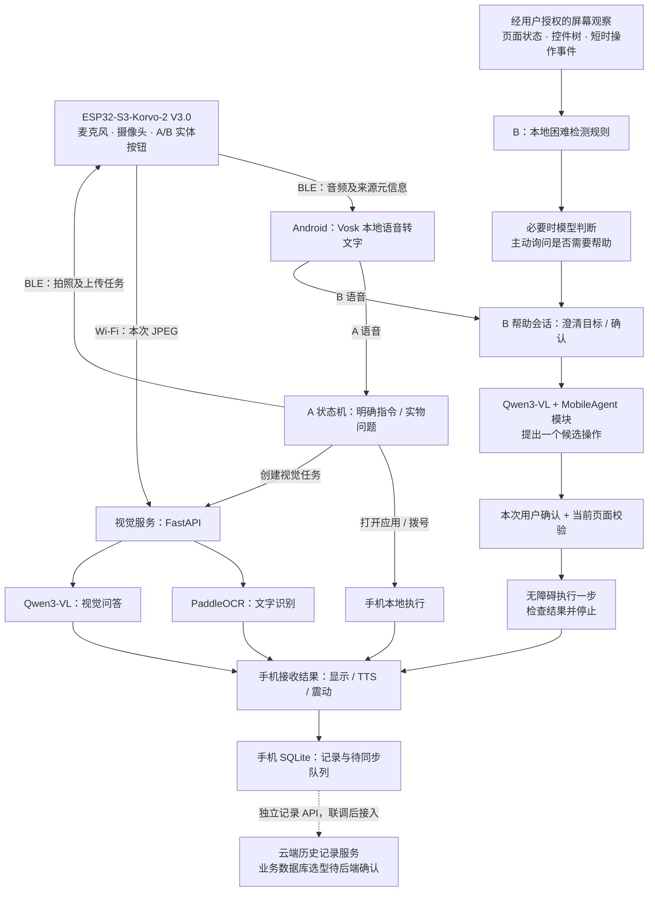

# Zhipal（知伴）作品介绍与技术方案

本稿依据当前 Android 项目及队友视觉服务交接材料整理。技术选型、产品方案与整机联调完成度分别表述；云端账号数据库尚未确认。

## 1. 一句话介绍作品

Zhipal（知伴）是一款面向老年人的软硬件协同生活助手，通过语音操控手机、视觉识读实物信息和操作受阻时的主动协助，帮助老人更独立、从容地处理数字生活中的日常事务。

## 2. 技术方案

系统采用“硬件采集—手机识别与执行—云端视觉分析”的整体架构，以 ESP32-S3-Korvo-2 V3.0 开发板为硬件核心，配合麦克风、外接摄像头及 A/B 两个实体按钮。音频和控制消息通过 BLE GATT 与 Android 手机通信，实物 JPEG 图片通过 Wi-Fi 上传视觉服务。手机完成本地语音转写、任务路由、应用启动、联系人拨号、状态反馈及记录存储；服务器负责文字识别、多模态理解和返回结构化结果。

### 使用的模型、框架与存储

| 类别 | 技术选型 | 用途与部署位置 |
| --- | --- | --- |
| 语音识别 | Vosk；中文模型 `vosk-model-small-cn-0.22` | APK 内置，接收硬件 WAV 后在手机本地转文字。Vosk Android SDK 版本为 0.3.47 |
| 实物文字识别 | PaddleOCR；配套部署模板指定 `PP-OCRv6_medium_det` 与 `PP-OCRv6_medium_rec` | 在电脑或服务器检测、识别文字，读取药盒说明、日期等可见信息；保留识别原文及图片证据 |
| 多模态模型 | `Qwen/Qwen3-VL-8B-Instruct`，通过硅基流动 API 调用 | 用于视觉问答、手机屏幕理解和候选下一步操作建议，权重不运行在 ESP32 上 |
| 手机端 | Kotlin、Android SDK；WebView + HTML/CSS/JavaScript | 原生层处理 BLE、权限、业务及系统操作，WebView 承载适老化展示界面 |
| 连接与后台 | Android BLE GATT、Foreground Service | 处理硬件收包、状态显示、已选设备记忆和自动重连；持续后台运行受手机系统策略约束 |
| 手机操作 | PackageManager、Intent、AccessibilityService | 按本机已安装应用名称查找并启动，按 App 内保存的联系人请求拨号；无障碍服务在用户授权后支持页面观测和一次确认后的界面操作 |
| Agent 实现 | 移植的 MobileAgent-Android 模块 + 自定义 A/B 状态机 | 结合截图、控件树和短时操作历史，澄清目标、提出单步建议、确认后执行一次并检查结果 |
| 视觉服务 | Python 3.11、FastAPI、Uvicorn；Docker / Render 部署方案 | 提供任务创建、JPEG 上传、状态查询及结果返回接口 |
| B 模型代理 | Node.js 22 标准库 HTTP 服务 | 配套代理提供兼容 Chat Completions 的接口，在服务端保管模型提供商密钥；可由团队网关统一入口 |
| 数据存储 | SQLite | 手机保存指令、执行结果及待同步记录；配套 OCR 服务保存任务状态，图片作为独立文件持久化 |
| 反馈 | Android 系统 TTS、页面状态、手机震动 | 朗读视觉结果并显示处理阶段、执行结果；硬件扬声器播放另需固件与音频输出链路配合 |

云端账号库及跨设备历史记录库的具体选型由后端同学确认。当前源码证据不能确定团队使用了 MySQL、PostgreSQL 或其他正式云数据库；图片上传接口也不能替代文字事件存储接口。

### A：明确指令与实物问答

用户双击 A 开始录音，再按一次结束；固件将带 A 来源信息的音频经 BLE 发给手机。手机使用 Vosk 转文字后进行任务路由：

- 手机操作：按应用名称查找已安装应用并请求启动，或按 App 内保存的称呼查找联系人并请求拨号。
- 实物问题：创建本次视觉任务，通过 BLE 请求硬件拍照，硬件通过 Wi-Fi 上传任务专属 JPEG；服务器按问题调用 OCR 或多模态能力，手机获取结果后显示、朗读并记录。

当前手机任务分类采用规则路由。文字识别读取可见包装信息，不根据识别结果生成个人用药方案。图像结果通过 task_id、frame_id 等标识与当前问题绑定，避免使用上一张照片回答新问题。

### B：操作困难检测与确认后的单步帮助

用户开启并授权 B 观察后，手机采集页面状态及短时操作事件，以页面持续停留等本地规则触发进一步判断，再结合截图和控件信息请求模型分析是否需要帮助。系统先询问，用户通过 B 按钮录音说明目标或回答确认；模型提出下一步操作，用户确认后，手机重新核对页面、执行一次并检查结果。

B 的语音只进入帮助会话，不进入 A 的普通命令分类。A/B 分别维护会话状态，A 触发时使旧 B 建议和迟到结果失效。操作历史采用短时内存窗口清理，避免持续保存完整屏幕录像。

### 整体技术架构

### 方案表述边界

Android 客户端代码、配套代理和部署模板不等同于真实硬件、云端所有服务已经联通。统一视觉接口、正式记录同步及后台运行效果仍应以团队整机验收为准。GUIDE、KnowU、Mobilerun 属于讨论中的参考思路，不应列作本项目已集成的模型或框架。

### 核对依据

- `app/build.gradle.kts`：Kotlin / Android 与 Vosk 依赖。
- `app/src/main/java/cn/seniorvoice/demo/OfflineSpeechClient.kt`：本地中文模型。
- `app/src/main/java/cn/seniorvoice/demo/BackendSync.kt`：SQLite 事件与待同步队列。
- `app/src/main/java/cn/seniorvoice/demo/assist/BAssistController.kt`：B 会话、观察和单步执行。
- `b_agent_proxy/server.mjs`：Qwen3-VL 模型和硅基流动代理。
- `deploy/medicine-vision/Dockerfile`：视觉服务运行环境及 OCR 权重名称。
- `docs/APP_SERVER_HANDOFF_参考原文.md`：队友视觉服务交接方案。
- `docs/0.7.8_集成完成度与实机联调.md`：当前集成状态及验收边界。
