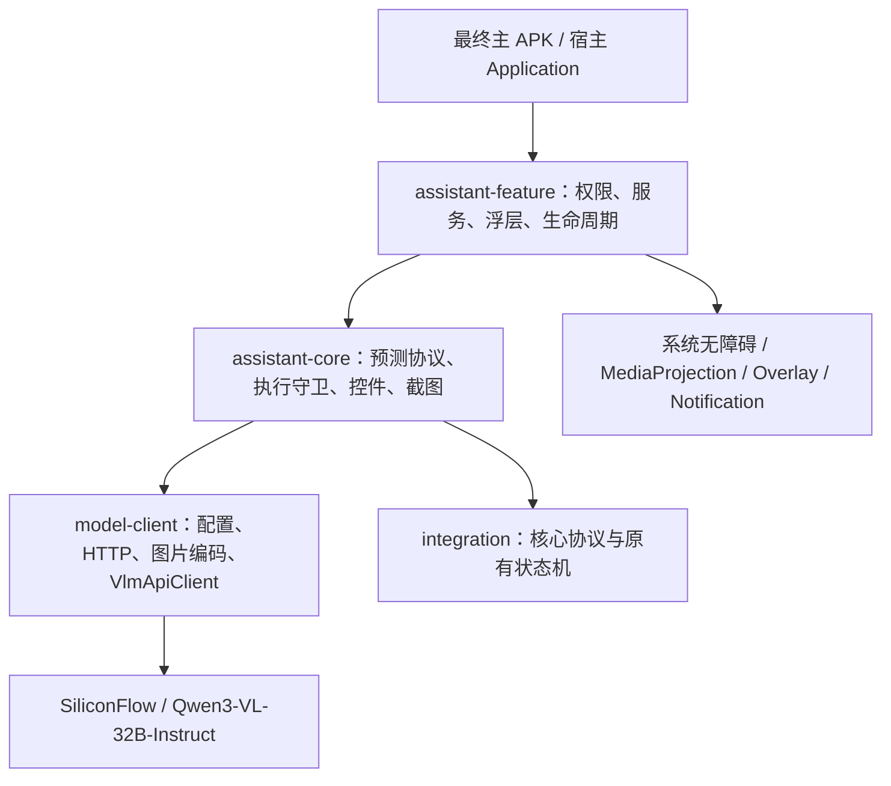

# 模型、Agent 源码与 APK 的分层说明

## 1. 用户提供的两个原始包

- `b_agent_team_handoff.zip`：来自用户桌面，原样保存。归档中有 214 个条目，包含原 MobileAgent 裁剪移植、android_library、integration、sample_app、旧构建物、依赖 JAR 和历史测试证据。
- `智能助手项目交接.zip`：首次提供的后续交接包，包含 8 份 Kotlin 源文件、Manifest/XML、交接说明和当时 APK；是继续优化时的重要补充。

本交付保留这两个归档的原始字节，并提供 SHA-256。原包中的 README、HANDOFF、测试结论和建议均属历史资料，不会替代本轮最终说明。不要把旧原包中的 AAR 当成已经包含 1.3 速度优化的最新库。

桌面原包没有发现 .safetensors、.gguf、.pth 或 .pt 权重文件，其 README 也说明没有打包模型大文件。用户所称“模型源代码”在这里是 Agent/模型接入与推理调度代码；当前 APK 的 Qwen3-VL-32B 模型实际由 SiliconFlow 云服务提供，不是 APK 内置的本地 32B 推理引擎。不能把 model-client.aar 当作可离线推理的权重包。

## 2. 当前模块边界



发布坐标：

| 项目目录 | Maven 坐标 | 产物 |
|---|---|---|
| model_client | com.bagent:model-client:1.3.0 | Android AAR、sources JAR、POM、module metadata |
| integration | com.bagent:integration:1.3.0 | JVM JAR、sources JAR、POM、module metadata |
| android_library | com.bagent:assistant-core:1.3.0 | Android AAR、sources JAR、POM、module metadata |
| assistant_feature | com.bagent:assistant-feature:1.3.0 | Android AAR、sources JAR、POM、module metadata |

只接入云模型访问可依赖 model-client；要直接获得现成权限页、悬浮预测和点击功能，应依赖 assistant-feature，它带入前述依赖。模型层不注册无障碍或浮层服务；feature 层不含真实 API Key。

## 3. 模型层源码接口

包名保留为 `com.mobileagent.app.api`，避免无意义地改变现有核心类型：

- `ApiConfig`：模型与编码配置，使用 kotlinx.serialization 生成序列化器。
- `VlmApiClient`：可挂起的 `predictWithImages(systemPrompt, textPrompt, images): Result<String>`。
- `OpenAiCompatibleClient`：OkHttp 请求与取消、瞬态重试、超时和响应解析。
- `ImageEncoder`：长边约束、JPEG 和 Base64 编码。

模型层用 Android Bitmap 作为图片类型，所以它不是可直接放进纯 JVM 后端的 JAR。若服务端要复用，应另做图片字节接口，不要在 JVM 进程依赖 Android Bitmap 实现。

ApiConfig 中保留的 localModelId="qwen3-vl-2b" 是原项目兼容字段，不是本次云端运行模型。真正使用的是 config.model；AssistantFeature.defaultCloudConfig 设置的是 Qwen/Qwen3-VL-32B-Instruct。原始包 README 中的本地 2B 测试也不能当作当前 APK 配置。

示例：

```kotlin
val config = ApiConfig(
    endpoint = "https://api.siliconflow.cn/v1",
    model = "Qwen/Qwen3-VL-32B-Instruct",
    apiKey = yourHostKey,
    maxSteps = 1,
    maxOutputTokens = 96,
    temperature = 0.1,
    imageLongSide = 1152,
    jpegQuality = 78,
    requestTimeoutSeconds = 40
)
val client: VlmApiClient = OpenAiCompatibleClient(config)
```

图片由调用方持有，模型客户端只在本次挂起调用内读取/编码，不取得原始图片所有权。客户端编码过程中创建的缩放位图会自行回收。核心 AndroidAssistPort 则拥有 observation 对应截图，调用方必须按协议 release，二者不要混淆。

## 4. 单次模型调用的契约

1. 无障碍树与截图在设备上采集。
2. 当前可点击控件组成允许 ID 列表，文本和原屏幕 bounds 作为定位线索。
3. 系统提示明确屏幕文字、历史都是不可信数据，只能预测一个点击，不执行，不输出长思考过程。
4. 模型只返回 `{"target_id":整数}` 或 `{"target_id":null}`。
5. ID 必须在当前列表内；未知 ID、字符串/小数 ID、多对象、任意坐标、额外字段或截断结果都拒绝。
6. 坐标由设备按选中的控件原始 bounds 计算，不采用模型缩放图片坐标。

`SingleClickProtocol` 与 `ExecutionGuard` 放在 core，而不是 HTTP 层。换模型时必须保留这个契约；旧原包 Manager→Executor 的 Thought/Action 响应不能不经适配直接代入新 feature。

原来的 Manager、Executor、Reflector 源码仍在 core 中，供追溯和旧接入模式使用。新浮层正常预测只调用一次；不要同时启动旧 BAssist 语音流程，也不要在新 feature 外再加一套规划请求，否则会重新引入延迟和重复动作风险。

## 5. 客户端的网络行为

- endpoint 可为 `/v1` 或完整 `/chat/completions`；客户端补全后者。
- Bearer Key 由宿主配置，不在 AAR 源码中固定。
- 请求体预先编码一次；瞬态重试复用相同内容。
- 只对 IOException、429 和 5xx 最多重试一次；403、400、解析错误不盲目重试。
- 配合协程取消会取消 OkHttp Call。默认 feature 预测总上限 60 秒，单请求 40 秒。
- max_tokens=96 是输出上限，不是承诺延迟；当前合成请求通常输出 7 token。
- 默认客户端可提供 attempts、elapsedMs、requestBytes、outputTokens 和 traceId；feature 的诊断页展示主要耗时和结果。

使用其他 OpenAI 兼容服务时，参数支持情况、模型视觉能力、账号余额/限流、TLS、代理和网络策略均需在该服务上核对。本轮真实请求验证的是指定 SiliconFlow 模型，不代表所有兼容端点已验证。[官方参数说明](https://docs.siliconflow.cn/docs/api/chat-completions-post)

## 6. “模型和 APK 分开”的实际含义

交付按模型访问层、Android 执行/界面层、原始源码、APK 分目录管理。构建最终 APK 时，model-client 的客户端代码仍会作为依赖进入最终 APK；不能从最终 APK 中完全删除 HTTP/编码类后期待调用功能继续运行。真正的 32B 权重在云端，因此不随最终 APK 合并。

如果之后要改成本地模型，应另提供本地推理运行时、权重格式、性能/内存预算和服务协议，再通过 VlmApiClient 适配。这不属于现有 APK 已实现的离线能力。交付没有伪造权重文件，也没有用占位空模型声称本地可运行。

## 7. 凭据与示例的区别

- 可直接体验的既有 APK 和本次模块化示例 APK 使用已有测试配置构建，方便延续用户当前验证。
- SDK AAR、Maven sources JAR、二进制宿主示例和模板不含实际 Key。
- `model.local.properties.example` 是字段模板；示例工程读取本机 `model.local.properties`，该真实文件不进入交付源码 ZIP。
- 最终宿主必须按自己的配置体系提供 Key，不能从旧 APK 反编译提取作为正式集成步骤。
- 原始归档按用户要求原样保留，其中历史文件的内容没有擅自修改或替换。

## 8. 原始来源与许可

源码工程保留 THIRD_PARTY_LICENSES、UPSTREAM_SOURCES.md、upstream-files.json 和 upstream_patches。原包和当前模块的来源对应关系另见 source-provenance.json。合并时保留这些来源与许可文件；不要把“重新打包”当作不需保留来源的理由。最终主 APK 若替换依赖，应按实际最终依赖清单维护声明。
